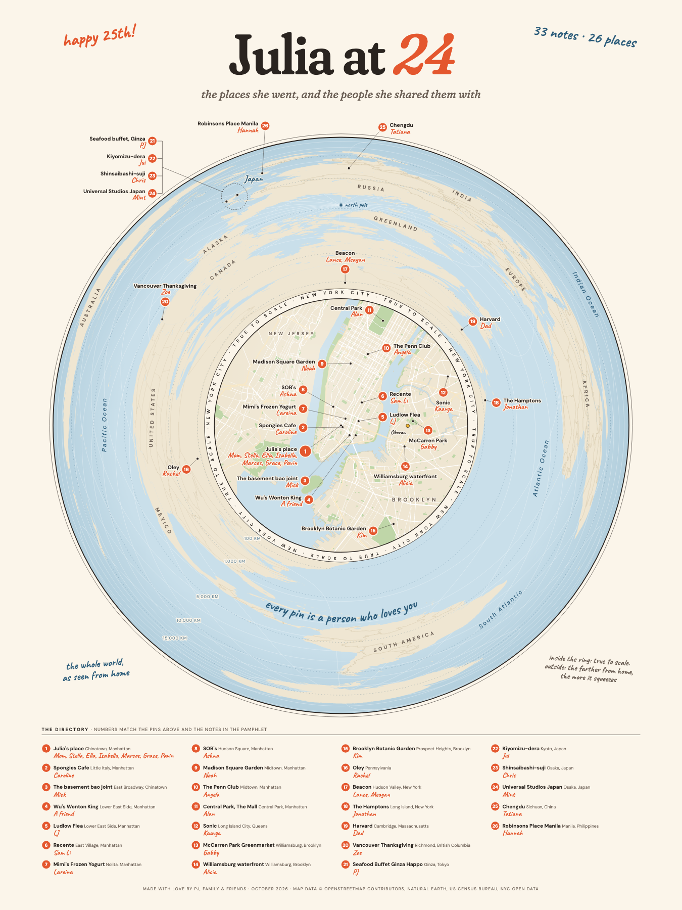

# Poster: "Julia at 24"

An 18 × 24 in vector poster that shows the world as seen from Julia's place. It
uses a fisheye azimuthal projection centred on her apartment:

- **Inside the ring (7.2 km around home)**, distances are true to scale. This
  shows lower Manhattan, Brooklyn and Queens with real streets and parks.
- **Outside the ring**, the rest of the world wraps around New York. The farther
  a place is from home, the more it gets squeezed, so Beacon, Japan and Manila
  all fit in one circle. The dashed rings mark 100, 1,000, 5,000, 10,000 and
  15,000 km from home.

Pin numbers match `num` in `data/memmap.json`, the directory key at the bottom
and the notes in the pamphlet.



## Files

| file | what it is |
| --- | --- |
| `poster.pdf` | Print this one: 18 × 24 in, vector, fonts embedded |
| `poster.svg` | The same artwork as an SVG (it uses the Google Fonts below) |
| `poster.html` | The SVG inlined with web fonts; it is the source for the PDF |
| `poster-preview.png` | 1350 × 1800 preview |
| `build_poster.mjs` | Builds `poster.svg` and `poster.html` from `data/memmap.json` |
| `prep_geo.mjs` | Downloads the map data once and caches compact copies in `geo/` |
| `render.sh` | Uses headless Chrome to write `poster.pdf` and `poster-preview.png` |

## Rebuild

```sh
cd poster
npm install
node build_poster.mjs   # also runs prep_geo.mjs if anything in geo/ is missing
./render.sh             # needs Google Chrome; set CHROME=/path/to/chrome to override
```

If a name or place changes, rerun `python3 scripts/build_data.py` from the repo
root, then run the two commands above. Pin and label positions are in the
`PLACE` table in `build_poster.mjs`. Each entry sets where the numbered badge
sits (`b`, in poster units where 100 = 1 inch) and which side the label goes
on. A leader line joins each badge to its true location.

## Printing tips

- Print `poster.pdf` at 18 × 24 in. It is fully vector, so it also scales
  cleanly to 9 × 12, 12 × 16 or 24 × 32 (any 3:4 size). For 24 × 36, choose
  "fit" and accept a small top and bottom margin.
- The paper colour (#FBF5EA) is part of the artwork. For a full-bleed cream
  look, ask the print shop to print edge to edge, or trim. On white paper with
  margins, it reads as a soft cream card.
- Matte or uncoated stock suits the hand-drawn feel. The smallest text (the
  credit line and the ring distances) is about 8 pt at 18 × 24 in. At 9 × 12 it
  is about 4 pt, which is tiny but still legible on a good printer.

## Data sources

- Countries: Natural Earth 1:10m (via the `world-atlas` npm package)
- US states: US Census Bureau cartographic boundaries 2023, 1:500k
- Lakes: Natural Earth 1:50m
- NYC shorelines: NYC Open Data borough boundaries
- Streets and parks inside the ring: © OpenStreetMap contributors (via the Overpass API)
